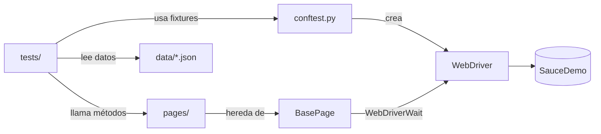

# Selenium + Pytest Framework (Page Object Model)


Framework de automatización de pruebas UI para la tienda demo [SauceDemo](https://www.saucedemo.com), construido con **Python, Selenium WebDriver y Pytest**, aplicando el patrón **Page Object Model (POM)**, pruebas data-driven y reportes HTML con evidencia automática.

---

##  Tabla de contenido

1. [Características](#-características)
2. [Stack tecnológico](#-stack-tecnológico)
3. [Estructura del proyecto](#-estructura-del-proyecto)
4. [Arquitectura](#-arquitectura)
5. [Requisitos e instalación](#-requisitos-e-instalación)
6. [Cómo ejecutar las pruebas](#-cómo-ejecutar-las-pruebas)
7. [Casos cubiertos](#-casos-cubiertos)
8. [Reportes y evidencias](#-reportes-y-evidencias)
9. [Decisiones de diseño](#-decisiones-de-diseño)
10. [Próximos pasos](#-próximos-pasos)
11. [Autor](#-autor)

---

##   Características

- **Page Object Model**: locators y acciones separados de la lógica de las pruebas.
- **Esperas explícitas** (`WebDriverWait`) en una `BasePage` reutilizable. Cero `time.sleep`.
- **Ejecución multi-navegador**: Chrome y Firefox mediante parámetro `--browser`.
- **Modo headless** con el flag `--headless`.
- **Pruebas data-driven** con `@pytest.mark.parametrize` y datos externos en JSON.
- **Markers** (`smoke`, `regression`, `negative`) para ejecutar subconjuntos de la suite.
- **Screenshot automático** al fallar un test, incrustado en el reporte HTML.
- **Ejecución en paralelo** con `pytest-xdist`.
- **Tests independientes**: cada test se ejecuta solo y en cualquier orden gracias a fixtures.

---

##   Stack tecnológico

| Herramienta | Uso |
|---|---|
| Python 3.10+ | Lenguaje base |
| Selenium 4.x | Automatización del navegador (incluye Selenium Manager, no requiere descargar drivers) |
| Pytest | Runner, fixtures, markers y parametrización |
| pytest-html | Reporte HTML autocontenido |
| pytest-xdist | Ejecución en paralelo |

---

##  Estructura del proyecto

```
selenium-pytest-framework/
├── pages/                  # Page Objects
│   ├── base_page.py        # Métodos reutilizables (click, type, waits)
│   ├── login_page.py
│   ├── inventory_page.py
│   ├── cart_page.py
│   └── checkout_page.py
├── tests/                  # Casos de prueba
│   ├── test_login.py
│   ├── test_inventory.py
│   ├── test_cart.py
│   └── test_checkout.py
├── utils/
│   ├── config.py           # URL base y timeouts
│   └── data_reader.py      # Lector de datos JSON
├── data/
│   └── users.json          # Datos de prueba
├── reports/                # Reportes y screenshots (ignorado por git)
├── conftest.py             # Fixtures y hook de screenshots
├── pytest.ini              # Configuración y markers
├── requirements.txt
└── README.md
```

---

##   Arquitectura



**Regla clave:** los tests nunca contienen locators ni llamadas directas a Selenium; solo invocan métodos de los Page Objects. Si la UI cambia, se actualiza un solo archivo en `pages/`.

---

##  Requisitos e instalación

**Requisitos previos**
- Python 3.10 o superior
- Google Chrome y/o Mozilla Firefox instalados

**Instalación**

```bash
# 1. Clonar el repositorio
git clone  https://github.com/Gkathe/selenium-pytest-framework
cd selenium-pytest-framework

# 2. Crear y activar entorno virtual
python -m venv venv
# Windows:
venv\Scripts\activate
# Mac/Linux:
source venv/bin/activate

# 3. Instalar dependencias
pip install -r requirements.txt
```

---

##   Cómo ejecutar las pruebas

| Objetivo | Comando |
|---|---|
| Toda la suite | `pytest` |
| Solo pruebas críticas | `pytest -m smoke` |
| Regresión sin negativos | `pytest -m "regression and not negative"` |
| Solo escenarios negativos | `pytest -m negative` |
| En Firefox | `pytest --browser firefox` |
| Sin interfaz gráfica | `pytest --headless` |
| Firefox + headless | `pytest --browser firefox --headless` |
| Un archivo específico | `pytest tests/test_login.py` |
| Filtrar por nombre | `pytest -k "bloqueado"` |
| En paralelo (4 workers) | `pytest -n 4` |

El reporte se genera automáticamente en `reports/report.html`.

---

##  Casos cubiertos

**Total: 20 casos automatizados**

| Módulo | Casos | Tipo | Qué valida |
|---|:---:|---|---|
| Login | 6 | smoke / negative | Login exitoso, usuario bloqueado, credenciales inválidas y campos vacíos (parametrizado) |
| Inventario | 5 | smoke / regression | Cantidad de productos y ordenamiento A-Z, Z-A, precio ascendente y descendente |
| Carrito | 5 | smoke / regression | Badge del carrito, agregar 1 y 2 productos, ver en carrito, quitar desde inventario y desde carrito |
| Checkout | 4 | smoke / negative | Flujo completo de compra y validación de campos obligatorios |

**Distribución por marker**

| Marker | Casos |
|---|:---:|
| `smoke` | 4 |
| `regression` | 8 |
| `negative` | 8 |

---

##   Reportes y evidencias

### Reporte HTML

>   *Agrega aquí una captura de `reports/report.html` con todos los tests en verde.*

```markdown

```

### Screenshot automático ante fallos

Cuando un test falla, el hook `pytest_runtest_makereport` de `conftest.py` captura la pantalla, la guarda en `reports/screenshots/` y la incrusta en el reporte.

> 📸 *Agrega aquí una captura de un test fallido con su imagen adjunta.*

```markdown

```

---

## 🧠 Decisiones de diseño

**¿Por qué Page Object Model?**
Separa el *cómo* se interactúa con la UI del *qué* se valida. Reduce duplicación y el mantenimiento se concentra en un solo lugar cuando cambia un locator.

**¿Por qué esperas explícitas y no `time.sleep`?**
Los `sleep` hacen la suite lenta y frágil (flaky). `WebDriverWait` espera solo lo necesario y falla con un mensaje claro si la condición no se cumple.

**¿Por qué fixtures en lugar de `setUp/tearDown`?**
Las fixtures de Pytest son composables y de alcance configurable. La fixture `inventory_page`, por ejemplo, reutiliza `login_page` y deja al usuario logueado, evitando repetir pasos en cada test.

**¿Por qué datos externos en JSON?**
Separa los datos de la lógica: se agregan escenarios nuevos sin tocar el código de los tests.

**¿Por qué un assert principal por test?**
Si un test falla, el nombre indica exactamente qué funcionalidad se rompió.

**¿Por qué tests independientes?**
Permiten ejecución en paralelo y en cualquier orden, sin efectos colaterales entre casos.

---

## 🚀 Próximos pasos

- [ ] Integrar **GitHub Actions** (ejecución en cada push/PR y matriz de navegadores)
- [ ] Migrar reportes a **Allure**
- [ ] Contenerizar con **Docker** y **Selenium Grid**
- [ ] Reimplementar la suite en **Playwright** y comparar métricas
- [ ] Agregar logging estructurado
- [ ] Cubrir `problem_user` y `performance_glitch_user` con `xfail` documentado

---

## 👤 Autor

**Tu Nombre** — QA Automation Engineer

- LinkedIn: [linkedin.com/in/tu-perfil](https://linkedin.com/in/tu-perfil)
- GitHub: [@tu-usuario](https://github.com/tu-usuario)
- Email: tu-correo@ejemplo.com

---

> ⚠️ Este proyecto se ejecuta contra [SauceDemo](https://www.saucedemo.com), un sitio creado públicamente para practicar automatización. Solo tiene fines educativos y de portafolio.